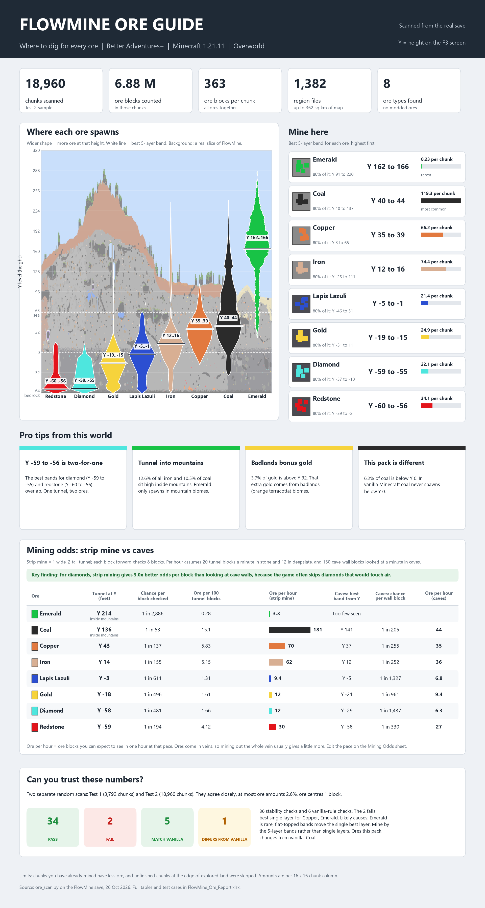

# Minecraft Ore Analyser

Find the best Y level for every ore in **your own** Minecraft world, including modded worlds with custom terrain.
The scanner reads the real blocks in your save (read-only), counts every ore at every height, and builds an Excel
report and a one-page infographic that any player can read.



> **AI-generated project.** This project was made with AI. The scripts, tests, documentation (this README,
> `plan.md`, `analysis.md`), the Excel report and the infographic were written by **Claude**, an AI model made by
> Anthropic, in a conversation with the project owner. The owner set the requirements, ran the scanner on their own
> Minecraft world and supplied the scan results. The code is checked by the automated tests in `tests/` (20 checks
> against synthetic worlds with known contents), and the workbook values were cross-checked against independent
> calculations. Read the code before you rely on it. Not affiliated with Mojang or Microsoft.

## What you get

- **Best place to mine** each ore: best 5-layer band, best single layer, where 80% of the ore is
- **How common** each ore is (ore blocks per chunk)
- **Mining odds:** best tunnel height, chance per block, ore per 100 tunnel blocks and ore per hour for strip
  mining, and the same for exploring caves
- **Vanilla checks:** which ores follow vanilla height rules and which ones the modpack changes
- **Test cases:** two independent scans compared, with PASS / FAIL results
- A **real cross-section** of your world drawn behind the charts

## Quick start: desktop app

```
python -m pip install -r requirements.txt
python ore_analyser_gui.py
```

1. Close the world in Minecraft. Press **Browse** and pick the world folder (or the `saves` folder if it holds one
   world). The app shows the Minecraft version and world seed it found.
2. Leave **Minecraft version** on *Auto-detect*. Pick a version only if detection is wrong: the list runs from the
   newest release down, and the note under it shows which save format that version uses.
3. Optional: type the modpack name (the save does not record it). Press **Scan and build**.
4. When it finishes, press **Open report** or **Open infographic**. Files are in `output/<world name>/`, so each
   world keeps its own results.

## Quick start: command line (Windows PowerShell)

```
$WORLD = "C:\path\to\.minecraft\saves\YourWorld"

# 1. Scan twice: a quick sample and a large, independent one (close the world first)
python scripts/ore_scan.py $WORLD --max-chunks 4000 --seed 42 --out output/test1
python scripts/ore_scan.py $WORLD --max-chunks 20000 --seed 7 --slice-width 1024 --out output/test2

# 2. Build the report and infographic (every number comes from the scans' world_info.json)
python scripts/build_report.py --modpack "Pack name"
python scripts/build_infographic.py --modpack "Pack name"

# 3. Optional: run the tests
python tests/test_ore_scan.py
```

Each scan writes `world_info.json` next to its CSVs: the Minecraft version and world seed read from the save, plus
the chunk counts, region files, skipped chunks, sample seed, date and cross-section location. The builders read
it, so nothing has to be copied from the console. Any `--chunks1`, `--world`, `--mc-version` and similar option
still overrides it; run `python scripts/build_report.py --help` for the list.

If the version in `level.dat` is wrong or missing, force it on the scan with `--mc-version`, for example
`--mc-version 1.21.11`. Releases that share a save format are handled the same way (see `scripts/mc_formats.py`):

| Save format | Releases | Region folders | World seed in |
|---|---|---|---|
| `anvil-1.18` | 1.18 to 1.21.11 | `region`, `DIM-1`, `DIM1` | `level.dat` |
| `dims-26.1` | 26.1 to 26.2 | `dimensions/minecraft/<name>/region` | `data/minecraft/world_gen_settings.dat` |
| `ids-26.3` | 26.3 and newer | as 26.1, with new block palette entries | as 26.1 |

Everything generated goes into `output/`, which git ignores. To rebuild the bundled sample:
`python scripts/build_report.py --test1 example/test1 --test2 example/test2 --out-dir example`.

Open the report in Excel. The file has no stored results, so Excel calculates every formula when it opens; a file
preview (for example in Explorer or a mail app) may show empty cells until then. For the exact look of the example,
install the free **Inter** font including its bold weight; without it the infographic uses Segoe UI (Windows) or
DejaVu Sans, and long text shrinks to fit.

## Is my save safe?

Yes. The scanner only opens region files in read-only mode and refuses to write its output inside the world
folder. The tests confirm both by hashing every world file before and after a scan. For extra safety, scan a copy
of the save.

## Project layout

| Path | What it is |
|---|---|
| `ore_analyser_gui.py` | Desktop app (CustomTkinter): scan and build with a few clicks |
| `scripts/ore_scan.py` | World scanner |
| `scripts/mc_formats.py` | Minecraft save formats and the release list |
| `scripts/common.py` | Shared rules, test limits and mining assumptions |
| `scripts/build_report.py` | Excel report builder |
| `scripts/build_infographic.py` | Infographic builder |
| `tests/` | Automated tests and synthetic world generators |
| `example/test1`, `example/test2` | Sample scan results (FlowMine world) |
| `example/FlowMine_Ore_Report.xlsx` | Sample Excel report |
| `example/FlowMine_Ore_Infographic.png` | Sample infographic |
| `plan.md` | Design, maths, test cases and how to run |
| `analysis.md` | Findings for the FlowMine world |

## Example results (FlowMine, Better Adventures+, Minecraft 1.21.11)

| Ore | Mine at Y |
|---|---|
| Emerald | 162 to 166 (mountains only) |
| Coal | 40 to 44 |
| Copper | 35 to 39 |
| Iron | 12 to 16 |
| Lapis Lazuli | -5 to -1 |
| Gold | -19 to -15 |
| Diamond | -59 to -55 |
| Redstone | -60 to -56 |

Full findings: `analysis.md`.

## Requirements

Python 3.9+, with `nbtlib`, `numpy`, `matplotlib`, `pandas`, `openpyxl` and `customtkinter` (see `requirements.txt`).
The desktop app also needs Tk, which the python.org installers include.
Works on Minecraft 1.18 and newer worlds, in both the older save layout (`region` folder) and the Minecraft 26.x
layout (`dimensions` folder). Tested on 1.21.11 and 26.3.
