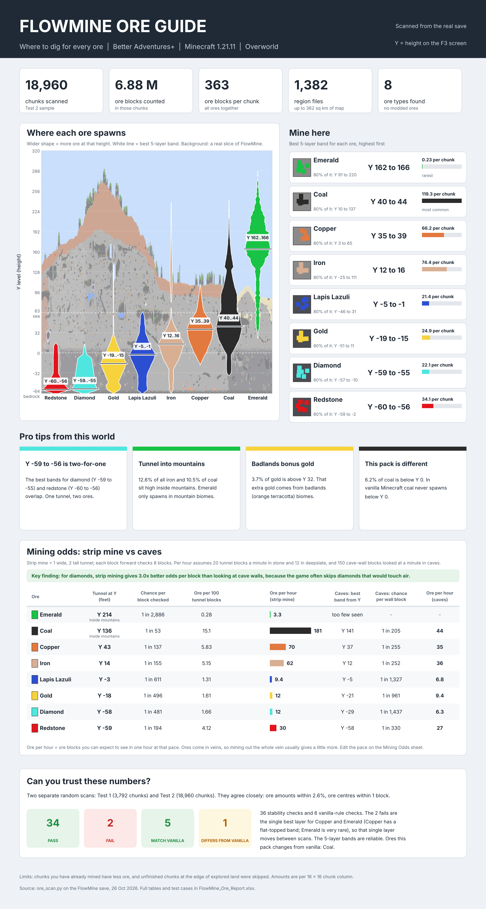

# Minecraft Ore Analyser

Find the best Y level for every ore in **your own** Minecraft world, including modded worlds with custom terrain.
The scanner reads the real blocks in your save (read-only), counts every ore at every height, and builds an Excel
report and a one-page infographic that any player can read.



> **AI-generated project.** This project was made with AI. The scripts, tests, documentation (this README,
> `plan.md`, `analysis.md`), the Excel report and the infographic were written by **Claude**, an AI model made by
> Anthropic, in a conversation with the project owner. The owner set the requirements, ran the scanner on their own
> Minecraft world and supplied the scan results. The code is checked by the automated tests in `tests/` (20 checks
> against synthetic worlds with known contents), and the workbook values were cross-checked against independent
> calculations. Read the code before you rely on it. Not affiliated with Mojang or Microsoft.

## What you get

- **Best place to mine** each ore: best 5-layer band, best single layer, where 80% of the ore is
- **How common** each ore is (ore blocks per chunk)
- **Mining odds:** best tunnel height, chance per block, ore per 100 tunnel blocks and ore per hour for strip
  mining, and the same for exploring caves
- **Vanilla checks:** which ores follow vanilla height rules and which ones the modpack changes
- **Test cases:** two independent scans compared, with PASS / FAIL results
- A **real cross-section** of your world drawn behind the charts

## Quick start (Windows PowerShell)

```
python -m pip install -r requirements.txt

$WORLD = "C:\path\to\.minecraft\saves\YourWorld"

# 1. Scan twice: a quick sample and a large, independent one (close the world first)
python scripts/ore_scan.py $WORLD --max-chunks 4000 --seed 42 --out output/test1
python scripts/ore_scan.py $WORLD --max-chunks 20000 --seed 7 --slice-width 1024 --out output/test2

# 2. Build the report and infographic (numbers from the scan console output)
python scripts/build_report.py --world YourWorld --chunks1 <Test 1 chunks> --chunks2 <Test 2 chunks> --regions <region files>
python scripts/build_infographic.py --world YourWorld --chunks1 <Test 1 chunks> --chunks2 <Test 2 chunks> --regions <region files>

# 3. Optional: run the tests
python tests/test_ore_scan.py
```

Everything generated goes into `output/`. See `plan.md` for every option and how each step works.

## Regenerate the report yourself

1. Close the world (or copy the save) and run both scans into `output/test1` and `output/test2` (commands above).
2. Note from each scan's console output: `scanned N full chunks from R region files` and
   `skipped_not_fully_generated: S`.
3. Build both outputs, passing those numbers and your world details:
   ```
   python scripts/build_report.py --world YourWorld --modpack "Pack name" --mc-version 1.21.11 --scan-date "1 Nov 2026" --slice "Z 2568, X 7168 to 8191" --chunks1 N1 --chunks2 N2 --regions R --skipped1 S1 --skipped2 S2
   python scripts/build_infographic.py --world YourWorld --modpack "Pack name" --mc-version 1.21.11 --scan-date "1 Nov 2026" --chunks1 N1 --chunks2 N2 --regions R
   ```
   The `--slice` text is printed by the Test 2 scan (`cross-section: Z=..., X ...`).
   With no options, both scripts rebuild the FlowMine report from the files in `output/`.
4. Open `output/YourWorld_Ore_Report.xlsx` in Excel. The file has no stored results, so Excel calculates every
   formula when it opens. A file preview (for example in Explorer or a mail app) may show empty cells until then.
5. Optional: install the free **Inter** font for the exact same look as the example. Without it the infographic
   uses Segoe UI (Windows) or DejaVu Sans, and long text shrinks automatically to fit.

Both builders always rebuild from the CSV files, so the same scan files always give the same report.

## Is my save safe?

Yes. The scanner only opens region files in read-only mode and refuses to write its output inside the world
folder. The tests confirm both by hashing every world file before and after a scan. For extra safety, scan a copy
of the save.

## Project layout

| Path | What it is |
|---|---|
| `scripts/ore_scan.py` | World scanner |
| `scripts/common.py` | Shared rules, test limits and mining assumptions |
| `scripts/build_report.py` | Excel report builder |
| `scripts/build_infographic.py` | Infographic builder |
| `tests/` | Automated tests and synthetic world generators |
| `output/test1`, `output/test2` | Scan results for the FlowMine world |
| `output/FlowMine_Ore_Report.xlsx` | Excel report |
| `output/FlowMine_Ore_Infographic.png` | Infographic |
| `plan.md` | Design, maths, test cases and how to run |
| `analysis.md` | Findings for the FlowMine world |

## Example results (FlowMine, Better Adventures+, Minecraft 1.21.11)

| Ore | Mine at Y |
|---|---|
| Emerald | 162 to 166 (mountains only) |
| Coal | 40 to 44 |
| Copper | 35 to 39 |
| Iron | 12 to 16 |
| Lapis Lazuli | -5 to -1 |
| Gold | -19 to -15 |
| Diamond | -59 to -55 |
| Redstone | -60 to -56 |

Full findings: `analysis.md`.

## Requirements

Python 3.9+, with `nbtlib`, `numpy`, `matplotlib`, `pandas` and `openpyxl` (see `requirements.txt`).
Works on Minecraft 1.18 and newer worlds (tested on 1.21.11).
